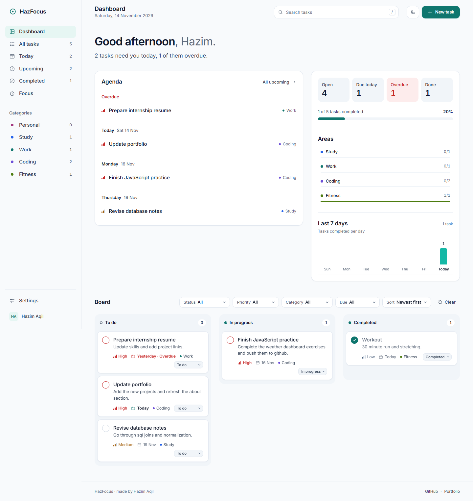

# HazFocus

A calm task and focus workspace built with plain HTML, CSS and JavaScript. Installable, works offline, and tested with Playwright.

[](https://github.com/hazell-lab/haz-focus/actions/workflows/tests.yml)

**[🔗 Live Demo](https://hazell-lab.github.io/haz-focus/)** · [Source code](https://github.com/hazell-lab/haz-focus) · [Portfolio](https://hazimaqil-portfolio.netlify.app)



## Description

HazFocus helps you plan your day and then get the work done. The dashboard is a personal workspace: an agenda of what is overdue, due today and coming up, progress for each area of your life, and a chart of what you finished over the last 7 days. Tasks move across a kanban board with drag and drop (mouse or touch), and a Pomodoro focus timer with a distraction-free mode helps you work through them.

Everything is saved in your browser with `localStorage`, you can download a backup at any time, and the app can be installed on a phone or computer and opened without a connection.

This project was built to practice core frontend skills without any framework or library, then tested end to end with Playwright and axe.

## Features

- **Task creation** with title, description, category, priority, due date and status
- **Editing** tasks in the same modal, with the data already filled in
- **Deleting** tasks with a custom confirmation modal
- **Completion** with one click, plus a restore option
- **Categories** (personal, study, work, coding, fitness) with live task counts
- **Priorities** (low, medium, high) with colour indicators
- **Due dates** with friendly formatting, plus due-today and overdue highlighting
- **Kanban board** with To do, In progress and Completed columns
- **Drag and drop** to move tasks between columns
- **Filtering** by status, priority, category and due date
- **Sorting** by newest, oldest, due date, priority or alphabetical order
- **Search** by title, description or category
- **Statistics** (open, due today, overdue, done) and a progress bar
- **Workspace dashboard** with an agenda (overdue, today and the next dated tasks grouped by day), area progress per category and a last 7 days chart of completed tasks and focus minutes, all from your own data
- **Schedule view**: when sorted by due date, task lists are grouped under day headings
- **Focus timer** (Pomodoro): 25 minute focus sessions, short breaks and a long break after every fourth session, with adjustable lengths, a soft chime, an optional notification when a session ends in the background, a "working on" task, today's focus time and a distraction-free mode
- **Keyboard shortcuts**: `N` new task, `/` search, `1`–`6` switch views, `Space` start or pause the timer, `R` reset it, `F` hide distractions, `Esc` close or clear
- **Views** for Dashboard, All tasks, Today, Upcoming and Completed
- **localStorage** for tasks, filters, theme, name and the focus timer (a running timer survives a page reload)
- **Backup and restore**: download your tasks, name, theme and focus settings and history as a JSON file from **Settings**, and restore it in any browser. Files are checked and cleaned before anything is replaced, and you confirm first
- **Installable app (PWA)**: add it to your home screen or desktop; it opens offline after the first visit, and a shortcut opens straight to the focus timer
- **Sample tasks** on the first visit, including a few finished earlier in the week so the dashboard chart has something to show
- Light and dark themes (cool slate with a teal accent), toast notifications, empty states
- Responsive design with a bottom tab bar, swipeable board lanes and bottom-sheet dialogs on phones
- Respects reduced-motion preferences

## Design

HazFocus uses one sans family (Inter) with weight and size for hierarchy, cool slate neutrals and a single calm teal accent (`#0f766e` in light, `#2dd4bf` in dark). Red is kept only for overdue and high-priority status. Cards and inputs use soft 10 to 16px corners, the board lanes are tinted surfaces and status chips are pills. All colour tokens live at the top of `css/style.css` and every text pair meets WCAG AA in both themes. Screenshots of the dashboard, board and focus view in both themes, at desktop and phone width, are in [`docs/slate-teal`](docs/slate-teal).

## Technologies

- HTML5
- CSS3 (custom properties, grid, flexbox, media queries)
- JavaScript (vanilla, ES6)
- localStorage
- Google Fonts (Inter) and an inline SVG icon sprite
- Web App Manifest and a service worker (offline support), the Notification API
- Playwright and axe-core for automated tests, GitHub Actions for CI

## JavaScript concepts demonstrated

- **DOM manipulation:** building cards with template literals and updating the page
- **Arrays and objects:** tasks are objects stored in an array
- **Array methods:** `map`, `filter`, `find`, `reduce`, `sort`
- **Event listeners:** clicks, input, change, submit and keyboard events, including event delegation
- **Drag and drop:** the HTML drag and drop events (`dragstart`, `dragover`, `drop`, `dragend`)
- **Date handling:** the `Date` object, friendly formatting, today, upcoming and overdue logic
- **localStorage:** saving and loading data with `JSON.stringify` and `JSON.parse`
- **Form validation:** custom error messages and `aria-invalid`
- **Files:** `Blob` downloads and `FileReader` for backup and restore, with validation of untrusted JSON
- **Service workers:** caching the app for offline use, network first so updates arrive straight away

## Folder structure

```text
Haz-Focus/
├── index.html
├── manifest.webmanifest   # install settings and icons
├── sw.js                  # service worker for offline use
├── README.md
├── LICENSE
├── package.json           # test tools only, the app has no build step
├── playwright.config.js
├── .github/workflows/
│   └── tests.yml          # runs the tests on every push
├── tests/                 # playwright tests
├── css/
│   └── style.css
├── js/
│   └── script.js
├── assets/
│   └── icons/             # favicon and app icons
└── docs/
    ├── screenshot.png
    └── slate-teal/
```

## Setup

1. Clone this repository (or download it as a ZIP):
   ```bash
   git clone https://github.com/hazell-lab/haz-focus.git
   ```
2. Open the `Haz-Focus` folder in **VS Code**.
3. Install the **Live Server** extension if you do not have it yet.
4. Right-click `index.html` and choose **Open with Live Server**.
5. The app opens in your browser at `http://127.0.0.1:5500`.

You can also open `index.html` directly in a browser. Installing the app and offline use need it to be served over `http` or `https` (Live Server or GitHub Pages), not opened as a file. An internet connection is needed for the Google Fonts the first time (the app falls back to system fonts without it).

## Testing

The tests use [Playwright](https://playwright.dev) and run every feature on a desktop and a phone screen: tasks, the board, the dashboard, the focus timer (with a fake clock, so no waiting), backup and restore, offline use and an [axe](https://github.com/dequelabs/axe-core) accessibility check of each main view in both themes.

```bash
npm install
npm test
```

Locally the tests use your installed Google Chrome. On GitHub, the workflow in `.github/workflows/tests.yml` installs Chromium and runs them on every push and pull request.

## Deploying

The app is static, so there is no build step. It is hosted on **GitHub Pages**: after every push to `main`, the workflow in `.github/workflows/tests.yml` runs the tests and, only if they pass, publishes `index.html`, `manifest.webmanifest`, `sw.js`, `css/`, `js/` and `assets/` to [hazell-lab.github.io/haz-focus](https://hazell-lab.github.io/haz-focus/).

To set it up on a fork, open **Settings → Pages** in the repository and set **Source** to **GitHub Actions**.

All paths in the app are relative, so it works from a subfolder like `/haz-focus/`. To test a copy served from a folder, run the tests with `BASE_URL`, for example `BASE_URL=http://127.0.0.1:4174/haz-focus/ npm test`.

## Notes

- Sample tasks appear only the first time you open the app. After that, your own saved tasks are used.
- Drag and drop works with a mouse, and on touch screens with a long press on a card. The status dropdown on each card also moves tasks.
- Your name for the greeting can be changed in **Settings**.
- Your data lives only in this browser. Use **Settings → Download backup** to keep a copy or move it to another device.
- To reset everything, clear the site data in your browser or use **Settings**.

## Future improvements

- User authentication
- Firebase or a backend database
- Cloud synchronization
- Recurring tasks
- Due-date reminders
- Month calendar view
- Subtasks
- Team collaboration
- A React version of the project

## Author

Built by **Hazim Aqil**, Software Engineering student at the German-Malaysian Institute (GMI).

- Portfolio: [hazimaqil-portfolio.netlify.app](https://hazimaqil-portfolio.netlify.app)
- GitHub: [@hazell-lab](https://github.com/hazell-lab)
- LinkedIn: [mdhazimaqil](https://www.linkedin.com/in/mdhazimaqil/)
